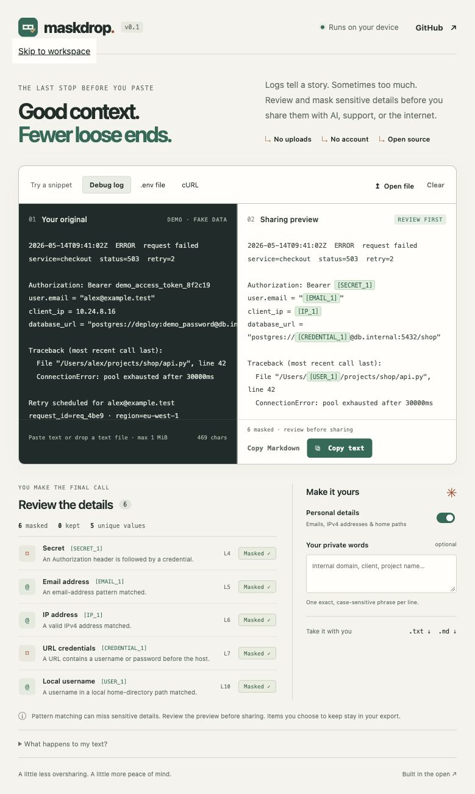

<div align="center">

# MaskDrop

### Review what leaves your clipboard.

Clean up logs, configs, and support snippets before sharing them with an AI assistant, a teammate, or a public issue.

**Local processing · No account · No AI service · Zero dependencies**

[Open the playground](https://kingsley506.github.io/maskdrop/) · [中文说明](README.zh-CN.md) · [Report a bug](https://github.com/kingsley506/maskdrop/issues/new?template=bug_report.yml)



</div>

Pasting an error log is easy. Noticing the token, email address, or connection password inside it takes another look. MaskDrop puts that look between **paste** and **share**.

```text
Before: user=alex@example.com API_KEY=example-secret-value
After:  user=[EMAIL_1] API_KEY=[SECRET_1]
```

*Illustrative example. The playground includes fictional samples you can try without supplying your own data.*

## Try it in a minute

1. Open the [playground](https://kingsley506.github.io/maskdrop/) and choose a sample.
2. Paste your text or drop a supported text file.
3. Review the findings, add private terms, and choose **keep** or **mask** for individual occurrences.
4. Copy the processed text or Markdown, or download a `.txt` / `.md` file.

Detection uses heuristics and can miss sensitive content or flag harmless values. Review the entire result before sharing. A finding you choose to **keep** remains visible in the exported text.

## Why use MaskDrop?

- **See the handoff.** Source, findings, and the share preview stay together.
- **Keep useful relationships.** Repeated values detected by the same rule family receive consistent placeholders within the text.
- **Make the judgment yourself.** Each finding has a reason; keep a harmless occurrence or mask it again.
- **Add what a pattern cannot know.** Enter company names, internal hosts, customer names, or other private terms, one per line.
- **Choose your scope.** Toggle personal-data detection or use secrets-only mode in the CLI.
- **Use the same core twice.** A browser workspace and a small Node CLI share the detection engine.

Good fits: debugging snippets for an AI chat, logs for a support ticket, configuration examples for documentation, and text destined for a public GitHub issue.

Supported file imports: `.txt`, `.log`, `.json`, `.env`, `.yaml`, `.yml`, `.md`, `.csv`, and `.sh`, up to 1 MiB (1,048,576 bytes). Files are read as text; MaskDrop does not parse PDFs, inspect images, or scan repository history.

## What it detects

| Rule family | Examples and boundaries |
| --- | --- |
| Credential formats | Recognizable OpenAI/Anthropic-style `sk-` keys, GitHub tokens, Slack tokens, AWS `AKIA` access-key IDs, and JWT-shaped strings. These are format checks, not verification that a credential is live. |
| Sensitive fields | Values assigned to password-, token-, API-key-, access-key-, and secret-like field names in common `.env`, JSON, YAML, and log syntax. This is text matching, not a full parser for every format. |
| Authentication data | Bearer and Basic authorization values, cookie headers, supported URL userinfo, and curl `--password` / `--user` arguments. |
| Private-key blocks | PEM blocks with recognized matching `BEGIN … PRIVATE KEY` and `END … PRIVATE KEY` markers. |
| Optional personal details | Email-shaped strings, valid IPv4-shaped addresses, and usernames in common macOS, Linux, and Windows home-directory paths. |
| Custom private terms | Exact, case-sensitive text you supply. Add terms explicitly when context matters. |

The rules do not cover every provider, syntax, credential, or type of personal data. They do not decode values, identify arbitrary names or phone numbers, or understand business context. Incomplete blocks, unusual escaping, split values, and unfamiliar formats may be missed. Review the entire output and add private terms where needed.

## Run locally

Requires Node.js 22 or newer. No package installation or build step is needed.

```sh
git clone https://github.com/kingsley506/maskdrop.git
cd maskdrop
node scripts/serve.js
```

Open [http://localhost:4173](http://localhost:4173).

For sensitive material, prefer a local copy whose source you have reviewed. A hosted page must be trusted with anything you paste into it, even when its intended processing is local.

## CLI

```sh
# Read stdin; write only processed text to stdout
node bin/maskdrop.js < debug.log > share.txt

# Explicit input and output files
node bin/maskdrop.js --file debug.log --out share.txt

# Focus on secrets, or add private terms (repeatable)
node bin/maskdrop.js --secrets-only --file debug.log
node bin/maskdrop.js --term AcmeCorp --term internal.example < debug.log

# Send a summary to stderr without including original values
node bin/maskdrop.js --report < debug.log > share.txt
```

The CLI does not upload input. Review its output before using it elsewhere.

## Privacy and limits

The application has no backend, analytics, external fonts, CDN scripts, account system, or AI API. Processing happens in the browser or your local Node process. The browser does not intentionally persist original text, and the app makes no remote data requests to process it. The hosting provider still receives ordinary page requests; visiting a link leaves the app.

Only the current processed content is copied or downloaded. MaskDrop does not export a restoration map. Values you deliberately keep remain in that content.

This is a sharing aid, not a guarantee that content is safe. It does not replace a repository secret scanner, a formal data-loss-prevention system, or a careful review. Unknown token formats, contextual information, encoded values, and personal details may remain. Browser extensions, clipboard history, and other software on your device are outside its control. See [SECURITY.md](SECURITY.md).

## Development

```sh
node --test
node scripts/serve.js
```

Small, reviewable changes and fictional regression examples are welcome. See [CONTRIBUTING.md](CONTRIBUTING.md) and the [changelog](CHANGELOG.md).

If MaskDrop saves you a second look, a star helps others find it. [MIT licensed](LICENSE).
