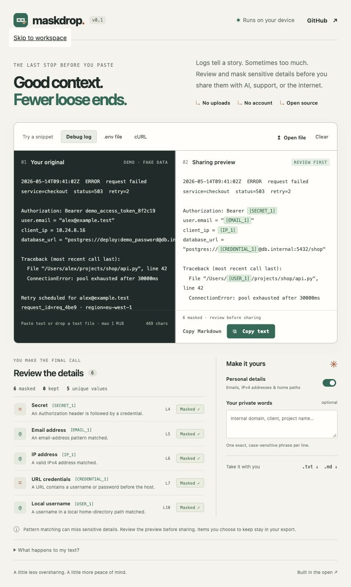

# MaskDrop

**分享之前，看清剪贴板里有什么。**

把日志、配置片段或报错信息发给 AI、同事或公开 Issue 之前，先在本地检查并替换可能敏感的内容。

**本地处理 · 无需账号 · 无 AI 服务 · 零依赖**

[在线体验](https://kingsley506.github.io/maskdrop/) · [English](README.md) · [提交问题](https://github.com/kingsley506/maskdrop/issues/new?template=bug_report.yml)



复制一段报错很容易，顺手带上令牌、邮箱或数据库密码也很容易。MaskDrop 把检查放在“粘贴”和“分享”之间。

## 怎么用

1. 打开[在线体验](https://kingsley506.github.io/maskdrop/)，先试试虚构的示例。
2. 粘贴文本，或拖入本地文本文件。
3. 查看检测原因，为每次出现的内容选择保留或替换；也可以补充自定义私密词。
4. 复制处理后的纯文本或 Markdown，或下载 `.txt` / `.md` 文件。

检测基于启发式规则，可能漏检或误判。分享前请检查完整结果。**手动选择保留的内容会原样出现在导出结果中。**

## 能解决什么问题

- 原文、检测结果和分享预览放在一起，方便核对。
- 同一类规则检测到的相同值使用一致的占位符，保留排错时需要的关联。
- 每条检测显示原因，可以按单次出现选择保留或替换。
- 自定义私密词每行一个，用来处理公司名、内部域名、客户名等规则不知道的信息。
- 支持开关个人信息检测，命令行也有仅处理密钥的模式。
- 浏览器与 Node 命令行使用同一个检测核心。

适合：向 AI 提问的日志片段、客服工单、公开 GitHub Issue、文档中的配置示例。

支持导入 `.txt`、`.log`、`.json`、`.env`、`.yaml`、`.yml`、`.md`、`.csv`、`.sh`，上限 1 MiB（1,048,576 字节）。文件按文本读取，不处理 PDF、图片或 Git 历史。

## 检测哪些内容

| 规则类型 | 示例与边界 |
| --- | --- |
| 凭据格式 | 可识别的 OpenAI/Anthropic 风格 `sk-` 密钥、GitHub 令牌、Slack 令牌、AWS `AKIA` 访问密钥 ID、JWT 形状的文本。只检查格式，不验证凭据是否有效。 |
| 敏感字段 | 常见 `.env`、JSON、YAML 和日志语法中，密码、令牌、API 密钥、访问密钥及 secret 类字段的值。基于文本匹配，不是每种格式的完整解析器。 |
| 身份验证信息 | Bearer / Basic 验证值、Cookie 头、支持的 URL 用户信息、curl 的 `--password` / `--user` 参数。 |
| 私钥块 | 含可识别且对应的 `BEGIN … PRIVATE KEY` 与 `END … PRIVATE KEY` 标记的 PEM 块。 |
| 可选个人信息 | 邮箱形状的文本、符合 IPv4 格式的地址、常见 macOS / Linux / Windows 主目录路径中的用户名。 |
| 自定义私密词 | 用户填写的精确文本，区分大小写。需要上下文的信息请主动添加。 |

规则没有覆盖所有平台、语法、凭据或个人信息类型，不会解码数据、识别任意人名和电话号码，也不理解业务上下文。不完整的块、特殊转义、拆开的值及未知格式可能漏检。请检查完整输出，并按需补充私密词。

## 本地运行

需要 Node.js 22 或更高版本，无需安装依赖或构建。

```sh
git clone https://github.com/kingsley506/maskdrop.git
cd maskdrop
node scripts/serve.js
```

打开 [http://localhost:4173](http://localhost:4173)。

处理敏感材料时，建议使用自己检查过源码的本地副本。即使网页设计为本地处理，你仍然需要信任它执行的代码。

## 命令行

```sh
# 从标准输入读取，向标准输出写入处理后的文本
node bin/maskdrop.js < debug.log > share.txt

# 指定输入与输出文件
node bin/maskdrop.js --file debug.log --out share.txt

# 仅检测密钥等凭据
node bin/maskdrop.js --secrets-only --file debug.log

# 自定义私密词，可重复传入
node bin/maskdrop.js --term AcmeCorp --term internal.example < debug.log

# 摘要写入 stderr，不包含原始值
node bin/maskdrop.js --report < debug.log > share.txt
```

命令行不会上传输入，使用处理结果前仍需人工核对。

## 隐私与边界

项目没有后端、统计分析、外部字体、CDN 脚本、账号系统或 AI API。处理在浏览器或本地 Node 进程中完成；浏览器不会主动持久化原文，处理过程不发送远程数据请求。托管平台仍会收到正常的网页访问请求；点击外部链接会离开应用。

复制和下载只包含当前处理后的内容，不会导出恢复映射。你主动保留的值仍会出现在其中。

MaskDrop 是分享前的检查工具，不能保证结果没有敏感信息，也不能替代代码仓库密钥扫描、正式的数据防泄漏系统或人工审阅。未知格式、编码后的值和需要上下文才能识别的信息可能漏检；浏览器扩展、剪贴板历史及设备上的其他软件不受本工具控制。详见 [SECURITY.md](SECURITY.md)。

## 开发与参与

```sh
node --test
node scripts/serve.js
```

欢迎提交小而明确的改进，以及使用虚构数据的回归示例。请先阅读 [CONTRIBUTING.md](CONTRIBUTING.md) 和[更新记录](CHANGELOG.md)。

如果它对你有用，可以点一颗 Star，帮助更多人发现它。[MIT 许可证](LICENSE)。
